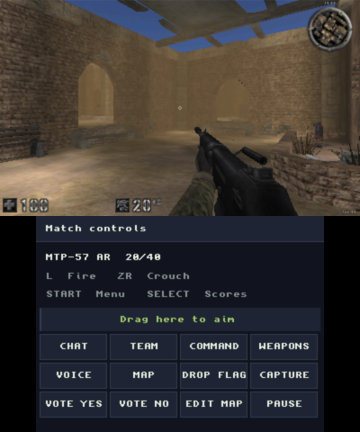

# AC3DS · AssaultCube 3DS

**A native port of AssaultCube 1.3.0.2 Lockdown Edition for New Nintendo 3DS, New Nintendo 3DS XL, and New Nintendo 2DS XL.** Play the original maps and modes with bots or connect to a compatible desktop server. The port uses Citro3D on the PICA200 GPU, NDSP audio, and touch controls tailored to the two screens.

[Install on your handheld](#install-on-your-handheld) · [Controls](#controls) · [Azahar results](#azahar-results)

## Screenshots

Captured in Azahar in New 3DS mode. The first two screenshots show both screens. Venison shows the 400×240 gameplay screen with water reflections and refraction enabled.

| Desert gameplay and touch controls | Map browser and preview | Venison water |
| --- | --- | --- |
|  |  |  |

## Install on your handheld

You’ll need a New Nintendo model with access to the Homebrew Launcher, a writable SD card, and a computer to build the `.3dsx`. This repository ships the port source. The build takes the stock game assets from the exact upstream archive you provide.

1. Install [devkitPro’s 3DS development tools](https://devkitpro.org/wiki/Getting_Started), including devkitARM, libctru, Citro3D, Picasso, 3dsxtool, smdhtool, and the 3DS zlib, Tremor and Ogg portlibs. Install Git, CMake 3.20 or later, and Python 3. Set `DEVKITPRO` to your SDK root.
2. Download the official [Lockdown Edition RC1 tar.bz2](https://github.com/assaultcube/AC/releases/download/v1.3.0.2/AssaultCube_v1.3.0.2_LockdownEdition_RC1.tar.bz2). Keep the archive intact. The staging script checks its SHA-256 and copies the asset files. The desktop installer is unnecessary.
3. Clone the repository and build it. Adjust the archive path if you downloaded it elsewhere. CMake fetches the pinned SDL2 and SDL2_image source revisions on the first configure.

   ```sh
   git clone https://github.com/rzkowskii/AC3DS.git
   cd AC3DS
   cmake -S . -B build-3ds \
     -DCMAKE_TOOLCHAIN_FILE=cmake/arm-3ds.cmake \
     -DCMAKE_BUILD_TYPE=Release \
     -DAC3DS_ASSET_ARCHIVE="$HOME/Downloads/AssaultCube_v1.3.0.2_LockdownEdition_RC1.tar.bz2"
   cmake --build build-3ds --parallel 4
   ```

4. Copy `build-3ds/assaultcube.3dsx` to `/3ds/assaultcube/assaultcube.3dsx` on the SD card. The default build embeds the stock assets in the executable. For sound, use your console’s existing `/3ds/dspfirm.cdc` or a homebrew loader that supplies the DSP component. [Audio setup](docs/audio-3ds.md)
5. Safely eject the card, put it back in your handheld, and open **AssaultCube** from the Homebrew Launcher. For a local match, select **Singleplayer** and choose a bot mode. Settings, custom content, screenshots, and logs are saved under `/3ds/assaultcube/profile/`.

To update, replace `assaultcube.3dsx` and keep the `profile/` folder. For an external asset layout, build with `-DAC3DS_EMBED_ASSETS=OFF`, run `python3 scripts/stage-assets.py /path/to/AssaultCube_v1.3.0.2_LockdownEdition_RC1.tar.bz2 build-3ds/sd-assets`, and copy the staged contents into `/3ds/assaultcube/` next to the executable.

## Controls

| Input | Match action |
| --- | --- |
| Circle Pad | Move and strafe |
| C-Stick or upper touch area | Aim |
| L / R | Fire / scope or weapon special action |
| A / B | Jump / knife attack |
| X / Y | Reload / previous weapon |
| ZL / ZR | Quick grenade / crouch |
| START / SELECT | Match menu / hold for scoreboard |

Open **Handheld controls** from the main menu or offline match menu to change bindings and tune aim. The touch screen also provides shortcuts for chat, weapons, map, voting, screenshots, and editing. [Full controls and remapping](docs/controls-3ds.md)

## Azahar results

The Venison fixture runs at 400×240 with eight Good bots, 128×128 reflection and refraction targets, and Azahar’s stock 100% CPU clock. Both water effects ran in every measured frame. The shared scene preparation lets refraction reuse matching world geometry, and reflection reuses the main view’s horizontal visibility and level-of-detail selection when compatible.

| Venison run | Mean FPS | 99th-percentile frame time | Missed VBlank callbacks |
| --- | ---: | ---: | ---: |
| Initial reproduction | 14.175 | 98.369 ms | 2,040 |
| Optimized sample | 59.898 | 16.758 ms | 0 |
| Optimized repeat | 59.843 | 16.758 ms | 0 |
| Default-build retest | 57.267 | 28.766 ms | 27 |
| Top-screen presentation update | 59.431 | 25.762 ms | 40 |

Each run measured 600 guest submission intervals. Combat, dynamic lighting, and death-camera transitions can still cause frame-time spikes. Handheld performance and full desktop feature parity remain unverified. Azahar checks have covered stock map and mode launches, bot combat, editor saves, original desktop demos, and a protocol-1300 connection to the original Lockdown Edition desktop server. [Verification details](docs/port-status.md) · [Reproduce the emulator tests](docs/emulator-qa.md)

The top-screen presentation update followed a New 2DS XL report of a black top screen at startup. It uses Citro3D’s standard target binding and keeps the experimental frame timing and GPU command changes disabled by default. The title, menu previews, touch controls and gameplay passed an Azahar retest. Physical retesting is pending.

## Documentation

- [Desktop multiplayer, dedicated server, and SD storage](docs/network-storage.md)
- [Native audio and DSP setup](docs/audio-3ds.md)
- [Apple Silicon build notes](docs/sdk-build.md)
- [Upstream release provenance](docs/release-evidence.md)

## Credits and licensing

AC3DS is maintained by [rzkowskii](https://github.com/rzkowskii). AssaultCube was created by Rabid Viper Productions and its contributors, building on the Cube engine by Wouter van Oortmerssen, Lee Salzman, and others. The port retains the upstream source notices. Game media has separate upstream terms. [AssaultCube source credits](source/README.txt) · [Cube engine license](source/README_CUBEENGINE.txt) · [ENet license](source/enet/LICENSE) · [Game asset terms](docs/upstream/license.html)
