# AC-3DS · AssaultCube for New Nintendo 3DS

**The real AssaultCube, running natively on the New Nintendo 3DS family** (New 3DS, New 3DS XL and New 2DS XL; tested on a New 2DS XL). This is a full port of AssaultCube 1.3.0.2 Lockdown Edition, not an emulator or a demake. You get the original maps, modes, weapons and bots, and you can join the same public servers as PC players. It is rebuilt around the handheld: a full-screen game view on top, and a dedicated touch screen for the radar, the map and your quick actions below.

<p align="center">
  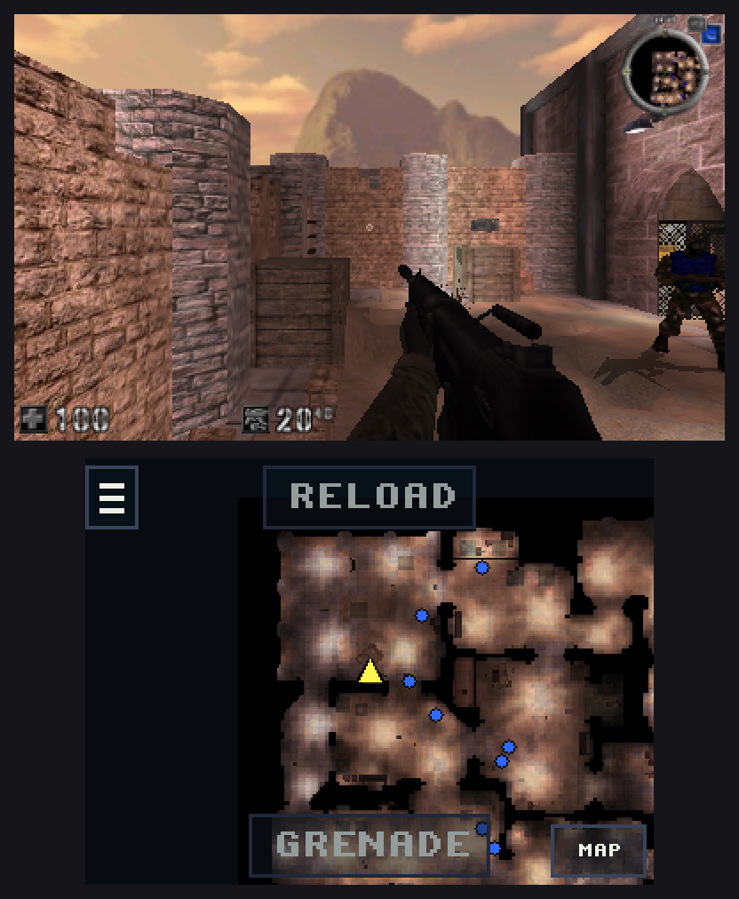
</p>

[Get it](#get-it-on-your-3ds) · [Screenshots](#screenshots) · [What's in the port](#whats-in-the-port) · [Performance](#performance) · [Build from source](#build-from-source) · [Controls](#controls)

## Highlights

- **Cross-play with PC.** The 3DS uses AssaultCube 1.3.0.2's own network protocol (1300). On a New 2DS XL it browses the public master server list, then joins, authenticates and plays on public PC servers.
- **Designed for two screens.** The top screen is the game, at the full 400×240. The bottom screen is your match screen:
  - a rotating close-range radar, or a north-up view of the whole map;
  - drag the stylus to look around, and double-tap to jump;
  - big translucent RELOAD and GRENADE buttons;
  - a small corner tab that slides out MENU, SCORES, WEAPON and CHAT, and stays out of the way while you play.
- **Fast loading.** The maps timed on a New 2DS XL load in 1.1 to 3.3 seconds (`ac_douze` 1.1 s, `ac_dusk` 2.3 s, `ac_arctic2` 2.8 s, `ac_alcove` 3.3 s). Early in the port the first map took 68 seconds.
- **Smooth play.** The game runs in New 3DS 804 MHz mode, synced to the top screen's 60 Hz refresh. In the Azahar emulator, six-bot matches run at 59.8 to 59.9 FPS. Once a map is running, the frame samples logged on the handheld during online play are mostly 14 to 17 ms.
- **Faithful to the original.** It has:
  - all 44 official maps and every stock game mode;
  - bots with the stock waypoints;
  - the map editor and demo playback;
  - water reflection and refraction, and stencil shadows;
  - fog that follows the PC game's.
- **Feels like a 3DS game.** The Nintendo software keyboard for chat. The online connection stays serviced for up to three minutes while the HOME menu or the keyboard is open. Offline matches pause on START. You can rebind every button, and the menus and server browser are laid out for the small screens.

## Screenshots

All captured in the Azahar emulator in New 3DS mode, with the top and bottom screens shown together.

| | |
| :---: | :---: |
| 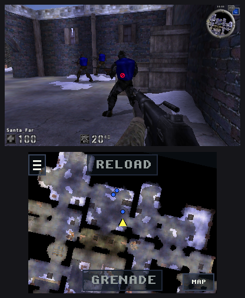 | 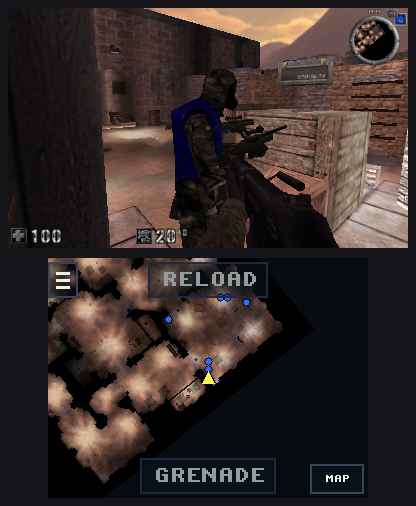 |
| **ac_arctic2**: bot team deathmatch, radar below | **ac_sunset**: up close |
| 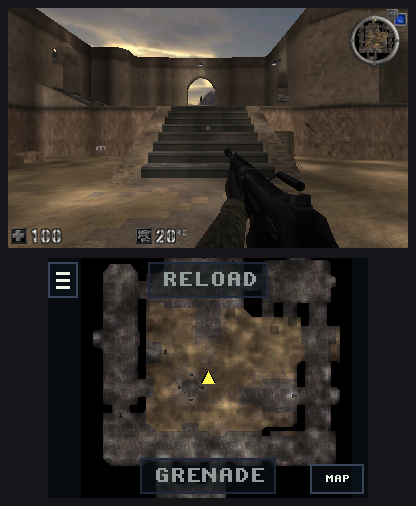 | 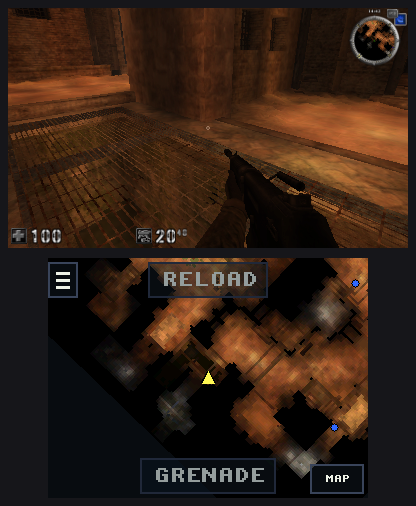 |
| **ac_douze**: open courtyard, PC-style fog | **ac_venison**: water reflection and refraction |
| 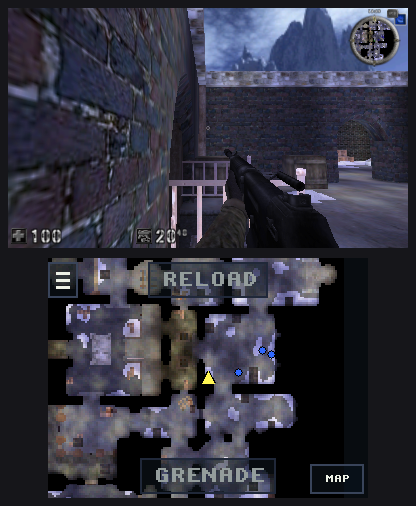 | 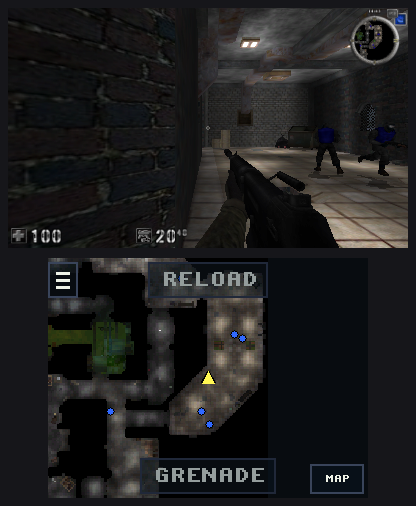 |
| **ac_arctic2**: snow, sky box and mountains | **ac_aqueous**: bots on the move |
| 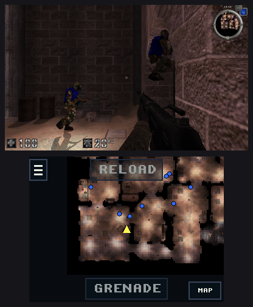 | 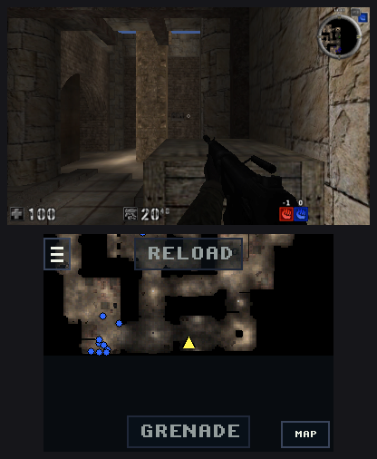 |
| **ac_sunset**: bots with stencil shadows | **ac_shine**: lit stone corridors |
| 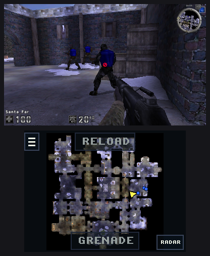 | 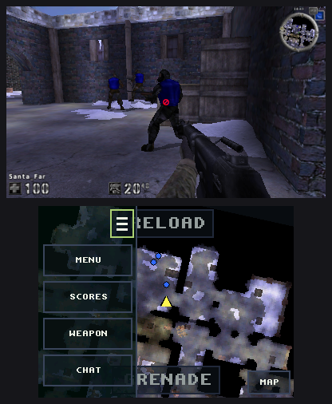 |
| **Touch screen**: whole-map overview (tap MAP) | **Touch screen**: slide-out drawer |
|  | 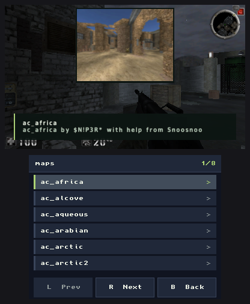 |
| **Main menu**: touch-friendly pages | **Map browser**: preview on top, list below |
| 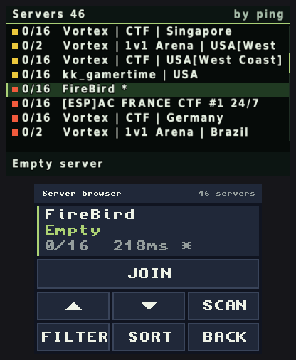 | 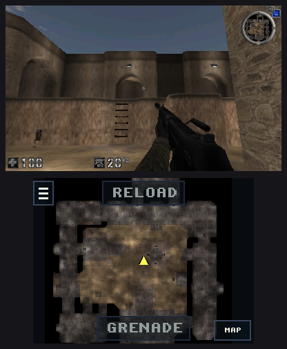 |
| **Server browser**: live public servers, one-tap JOIN | **ac_douze**: the ramparts |

## Get it on your 3DS

You need a New Nintendo 3DS, New 3DS XL or New 2DS XL running the Homebrew Launcher (for example with Luma3DS). The original 3DS and 2DS are not supported, because the port needs the New models' extra memory and CPU. For sound, the console needs the usual `sdmc:/3ds/dspfirm.cdc` DSP dump. [Audio setup](docs/audio-3ds.md)

AssaultCube's game content (maps, textures, models and sounds) may only be shared inside the unmodified official package, unless a file carries its own license. So the release here is the game engine for the 3DS, and you add the game files from the official download. It takes a couple of minutes:

1. Download the latest `AC-3DS0v….zip` from [Releases](https://github.com/rzkowskii/AC3DS/releases) and unzip it. It contains `assaultcube.3dsx` and `stage-assets.py`.
2. Download the official [AssaultCube v1.3.0.2 Lockdown Edition RC1 (tar.bz2)](https://github.com/assaultcube/AC/releases/download/v1.3.0.2/AssaultCube_v1.3.0.2_LockdownEdition_RC1.tar.bz2). Keep the archive as it is.
3. Stage the game files with Python 3 on Windows, macOS or Linux (on Windows, run `py` instead of `python3`). The script checks the archive's SHA-256 and copies only the game's data folders (`config`, `packages`, `bot` and so on), leaving out the PC programs and source.

   ```sh
   python3 stage-assets.py AssaultCube_v1.3.0.2_LockdownEdition_RC1.tar.bz2 sd-assets
   ```

4. Copy the contents of `sd-assets/` and the release's `assaultcube.3dsx` into `/3ds/assaultcube/` on the SD card. You end up with `/3ds/assaultcube/assaultcube.3dsx`, `/3ds/assaultcube/config/`, `/3ds/assaultcube/packages/` and so on.
5. Open **AC-3DS0** (the title carries the version, for example AC-3DS0v1.0) in the Homebrew Launcher. Pick **Singleplayer** for a bot match, or **Multiplayer** to browse servers.

Settings, screenshots, demos and logs go to `/3ds/assaultcube/profile/`. To update, replace `assaultcube.3dsx` and keep everything else.

Optional: the script can also convert progressive JPEG textures to baseline JPEG, which keeps the pixels identical. In a host test those textures decoded about twice as fast, so maps should load a little quicker. You need `jpegtran` (libjpeg-turbo) and a C compiler installed, and you pass SDL_image's `stb_image.h` with `--stb-image`. A source build passes `--stb-image` for you, so it only needs `jpegtran` and a C compiler.

## What's in the port

AssaultCube targets desktop OpenGL and a mouse. The 3DS has a PICA200 GPU with no fragment shaders, 124 MB of usable RAM, a 804 MHz ARM11, two screens and a stylus. The port keeps AssaultCube's game logic and network protocol, changes the engine only where the 3DS needs it, and rebuilds the platform layer around it.

**Rendering**
- An OpenGL 1.x layer on top of Citro3D drives the PICA200 directly, at 400×240.
- World geometry is drawn in large batches, and reused across frames while the view holds still.
- Water uses render-to-texture reflection and refraction. The refraction reuses the main view's world geometry, and the reflection reuses its visibility pass.
- Characters cast stencil shadows.
- Fog is computed per pixel from eye distance (the PICA's procedural texture unit plus one combiner stage), so it follows the PC game's linear falloff.

**Speed**
- New 3DS 804 MHz mode with the extra cache enabled.
- While a map loads, its textures are decoded on two cores at once: the second application core and the main thread.
- Game sounds are decoded in the background at startup.
- With `jpegtran` installed, progressive JPEGs are converted to baseline as the files are staged.
- Bots also use the 11 stock waypoint files the PC game rejects for a blank map name, instead of rebuilding waypoints at match start. Eight of them state a wrong waypoint count; the loader takes the count from the file's records.

**Two screens**
- A dedicated match screen, built from the map's own GPU-drawn overview.
- The radar uses the PC radar's own rules: teammates and flags, and no opponents except a Keep the Flag carrier.
- Menus and the server browser are laid out for the 3DS, with large touch targets and readable text.

**Network**
- ENet runs over the 3DS socket service.
- Connections to the master and package servers make their TCP connect on a helper thread with a timeout, which the 3DS socket service needs. The server list then loads behind a progress bar you can cancel.
- Content a custom map needs is fetched from the package server during the map change, for at most 30 seconds while online (`ac3dsdownloadwait`). The server connection stays serviced meanwhile, and START skips the download.
- A helper thread keeps the server connection serviced for up to three minutes while the keyboard or HOME menu is open; after that the server times the console out.
- The 3DS can also run AssaultCube's dedicated server. So far it has been tested in Azahar, where it answers server-browser queries. [Network play](docs/network-storage.md)

**Robustness**
- A crash handler and a stall watchdog write `crash.txt` or `stall.txt` to the SD card, keep the five before it, and record the map, memory and last log lines.
- Settings are written to a temporary file and swapped in, with a backup kept, so an interrupted save shouldn't lose them.

## Feature parity

| Area | Status on 3DS |
| --- | --- |
| Maps and modes | All 44 official maps and all stock modes load, including CTF, team modes, one-shot-one-kill and the bot modes |
| Bots | Stock AssaultCube bots with waypoints |
| Online play | Protocol 1300: master list, direct connect and play on public servers. Favourites, LAN, votes, admin and map downloads use the stock code but are not yet tested on 3DS |
| Graphics | Original textures (scaled to 256 px), models, sky boxes, water reflection and refraction, stencil shadows, dynamic lights, PC-style fog |
| Audio | Original sounds and ambience on the 3DS DSP, with distance falloff and stereo panning |
| Editor and demos | Map editor with undo, redo and map saving; demo playback with seeking |
| Input | Circle Pad, C-Stick, touch aim, full button remapping, and the software keyboard for chat and console |
| Not included | Desktop-only options such as screen resolution, fullscreen, vsync and antialiasing, and the desktop server wizard |

## Performance

| Where | What | Result |
| --- | --- | --- |
| New 2DS XL | CPU clock | 804 MHz mode active |
| New 2DS XL | Map load | `ac_douze` 1.1 s, `ac_dusk` 2.3 s, `ac_arctic2` 2.8 s, `ac_alcove` 3.3 s |
| New 2DS XL | Online on `ac_douze` | Five single-frame samples during play: 14, 16, 17, 17 and 21 ms |
| New 2DS XL | Texture loading on `ac_alcove` | All 61 queued textures were ready before use, decoded ahead on both cores (36 on the second core) |
| Azahar, New 3DS mode | `ac_arctic2`, six bots, standing still | 59.8 FPS mean, 20.5 ms 99th percentile, no missed refreshes |
| Azahar, New 3DS mode | `ac_douze`, six bots, camera turning | 59.8 FPS mean, 19.1 ms 99th percentile |
| Azahar, New 3DS mode | `ac_venison`, eight bots, camera turning | 59.8 FPS mean, 17.5 ms 99th percentile |

Emulator figures are from Azahar at its stock CPU clock, which does not model GPU time, so they are not handheld measurements. `ac3dsbench` in the console runs the same turning-camera benchmark on the handheld and writes the results to the log. [Detailed status](docs/port-status.md) · [Emulator test fixtures](docs/emulator-qa.md) · [3DS hardware notes](docs/3ds-hardware.md)

## Controls

| Input | In a match |
| --- | --- |
| Circle Pad | Move and strafe |
| C-Stick, or drag on the touch screen | Aim |
| Double-tap the touch screen | Jump |
| L / R | Fire / scope or weapon special |
| A / B | Jump / knife |
| X / Y | Reload / last weapon |
| ZL / ZR | Quick grenade / crouch |
| D-Pad | Primary / secondary weapon (up / down), previous / next weapon (left / right) |
| START / SELECT | Match menu / hold for scores |
| Touch: RELOAD, GRENADE, MAP | Reload, throw a grenade, switch radar and map |
| Touch: corner tab | Menu, scores, next weapon, chat |

Open **Handheld controls** from the main menu to rebind buttons and tune aiming. [Full controls](docs/controls-3ds.md)

## Build from source

The source build embeds the game files in the `.3dsx`, so the result is a single file. It is for your own use. Don't redistribute it.

1. Install [devkitPro's 3DS tools](https://devkitpro.org/wiki/Getting_Started): devkitARM, libctru, Citro3D, Picasso, 3dsxtool, smdhtool, and the 3DS zlib, Tremor and Ogg portlibs. You also need Git, CMake 3.20 or later, and Python 3. Set `DEVKITPRO` to the SDK root.
2. Download the official [Lockdown Edition RC1 tar.bz2](https://github.com/assaultcube/AC/releases/download/v1.3.0.2/AssaultCube_v1.3.0.2_LockdownEdition_RC1.tar.bz2).
3. Build:

   ```sh
   git clone https://github.com/rzkowskii/AC3DS.git
   cd AC3DS
   cmake -S . -B build-3ds \
     -DCMAKE_TOOLCHAIN_FILE=cmake/arm-3ds.cmake \
     -DCMAKE_BUILD_TYPE=Release \
     -DAC3DS_ASSET_ARCHIVE="$HOME/Downloads/AssaultCube_v1.3.0.2_LockdownEdition_RC1.tar.bz2"
   cmake --build build-3ds --parallel 4
   ```

   CMake downloads the pinned SDL2 and SDL2_image sources on the first configure.
4. Copy `build-3ds/assaultcube.3dsx` to `/3ds/assaultcube/assaultcube.3dsx` on the SD card and start it from the Homebrew Launcher.

To build the engine-only `.3dsx` used for releases, add `-DAC3DS_EMBED_ASSETS=OFF` and leave out `AC3DS_ASSET_ARCHIVE`. It uses the port's own launcher icon (`source/3ds/icon.png`). The launcher title comes from the `RELEASE_NAME` file, and the build number from `BUILD_NUMBER`. [Apple Silicon notes](docs/sdk-build.md)

## Documentation

- [Controls and remapping](docs/controls-3ds.md)
- [Network play, hosting a server, and SD storage](docs/network-storage.md)
- [Audio and DSP setup](docs/audio-3ds.md)
- [3DS hardware notes](docs/3ds-hardware.md)
- [Development status and measurements](docs/port-status.md)
- [Upstream release provenance](docs/release-evidence.md)
- [Third-party notices](docs/third-party-notices.md)

## Credits and licensing

AC-3DS is a port by [rzkowskii](https://github.com/rzkowskii). AssaultCube was created by Rabid Viper Productions and its contributors, building on the Cube engine by Wouter van Oortmerssen. This port is not affiliated with or endorsed by the AssaultCube team or Nintendo.

- **Source code:** AssaultCube's source code is under its zlib-style license, which this repository keeps ([source/README.txt](source/README.txt), [source/README_CUBEENGINE.txt](source/README_CUBEENGINE.txt)). ENet, SDL, libctru, Citro3D, Tremor and zlib keep their own licenses ([third-party notices](docs/third-party-notices.md)).
- **Game content:** maps, textures, models and sounds are not in this repository or the release. They come from your own copy of the official package, under [AssaultCube's terms](docs/upstream/license.html). AssaultCube is freeware and may not be used commercially.
