# AC-3DS · AssaultCube for New Nintendo 3DS

**The real AssaultCube, running natively on the New Nintendo 3DS family** (New 3DS, New 3DS XL and New 2DS XL). This is a full port of AssaultCube 1.3.0.2 Lockdown Edition, not an emulator or a demake. You get the original maps, modes, weapons and bots, and you can join the same public servers as PC players. It is rebuilt around the handheld: the game on the top screen, and a touch screen below for the radar, the map, aiming and your quick actions.

<p align="center">
  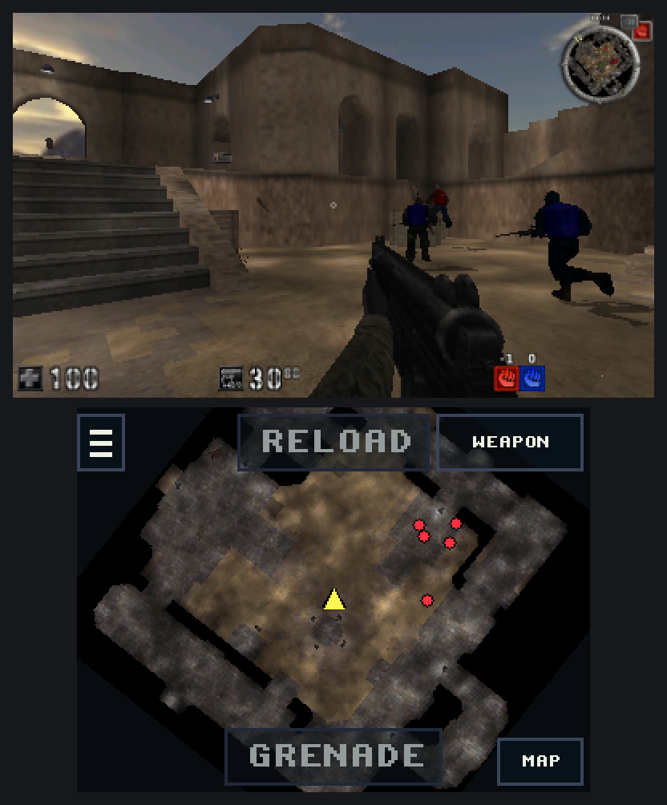
</p>

[Get it](#get-it-on-your-3ds) · [Screenshots](#screenshots) · [What's new](#whats-new-since-v10) · [Known issues](#known-issues) · [Controls](#controls) · [Build from source](#build-from-source) · [Licensing](#licensing-and-what-is-distributed)

**Status: build 26 (`AC-3DS0v1.14`).** On my New 2DS XL build 26 starts from the Homebrew Launcher and plays well; earlier builds have played bot matches and joined public PC servers on it. The first-run download ran on the console in build 24; its faster one-file form in build 26, and the builder, are so far checked only in the Azahar emulator. One visible fault is open on the console: [the weapon in hand can ghost while you move](#known-issues). The New 3DS and New 3DS XL are the same hardware apart from the 3D screen, but I have not run it on one.

## What you get

- **Cross-play with PC.** The 3DS speaks AssaultCube 1.3.0.2's own network protocol (1300). On the console it browses the public server list, then joins, authenticates and plays on public PC servers.
- **Two screens, used properly.** The top screen is the game at the full 400×240. The touch screen is the match screen: a rotating radar or the whole map, drag to aim, double-tap to jump, and RELOAD, WEAPON, GRENADE and SCOPE buttons under your thumb.
- **The whole game.** All 44 official maps and every stock mode, bots with the stock waypoints, the map editor, demo playback, water reflection and refraction, stencil shadows, and fog that follows the PC game's.
- **Quick to load, smooth to play.** The console runs in 804 MHz mode, synced to the top screen's 60 Hz. Maps timed on the console load in 1.1 to 3.3 seconds, and logged frames during online play are mostly 13 to 17 ms.
- **Feels like a 3DS game.** Chat uses the Nintendo software keyboard, offline matches pause on START, every button can be rebound, and the menus and server browser are laid out for the small screens with large touch targets.
- **Nothing to install on a computer if you don't want to.** Copy one small file to the SD card and the console fetches the official game package itself.

## Screenshots

Every picture here is the running game, captured at native resolution in the Azahar emulator in New 3DS mode: the top screen (400×240) above the touch screen (320×240), as on the console.

### In a match

| | |
| :---: | :---: |
| 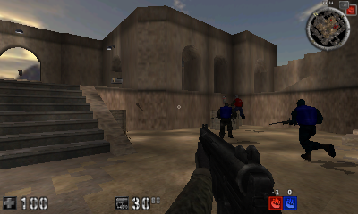 | 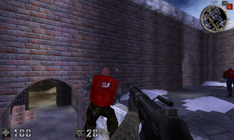 |
| **ac_douze** · long sight lines, PC-style fog | **ac_arctic2** · snow and brick |
| 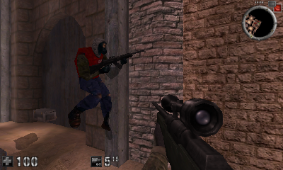 | 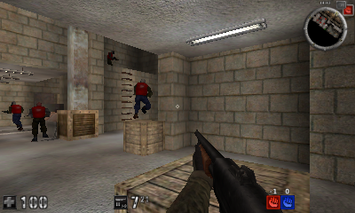 |
| **ac_sunset** · stone alleys | **ac_power** · bright interiors |
| 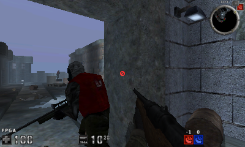 | 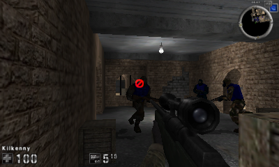 |
| **ac_snow** · a frozen street | **ac_desert** · lamp-lit cellars |
| 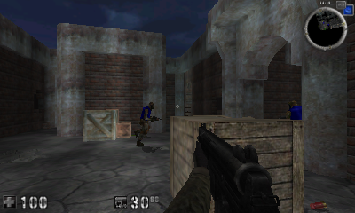 | 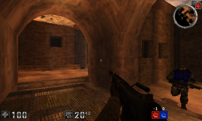 |
| **ac_gothic** · night sky | **ac_venison** · warm stone vaults |

### The touch screen

| | |
| :---: | :---: |
| 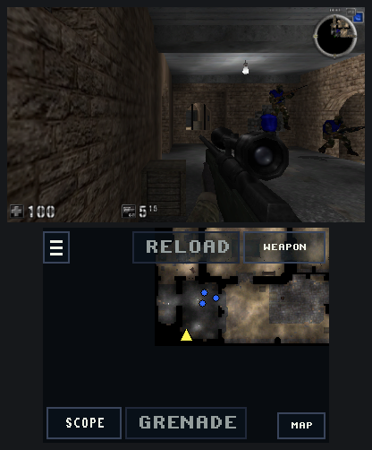 | 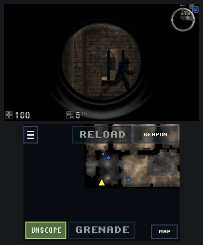 |
| **Match screen** · radar, drag to aim, quick actions | **SCOPE** · tap to zoom the sniper rifle, tap UNSCOPE to leave |
| 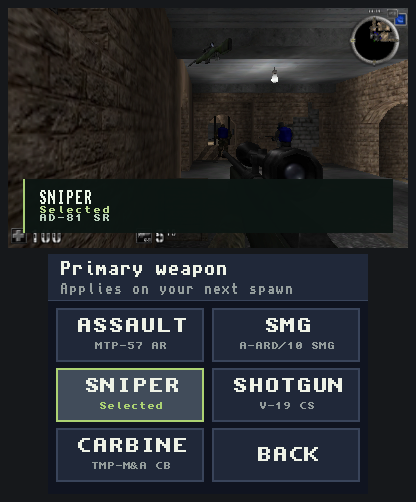 | 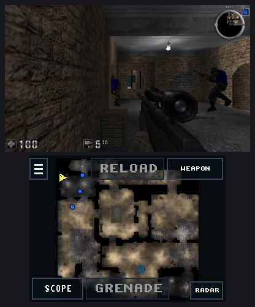 |
| **Weapon picker** · tap WEAPON, lift on a tile to choose | **Whole map** · tap MAP, tap RADAR to go back |

### Dying, respawning and the score

| | |
| :---: | :---: |
| 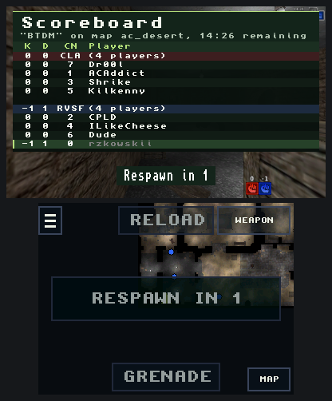 | 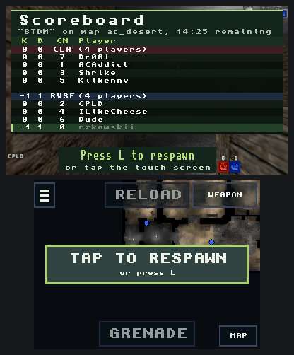 |
| **Respawn countdown** on both screens | **Press L or tap** when the wait is over |
| 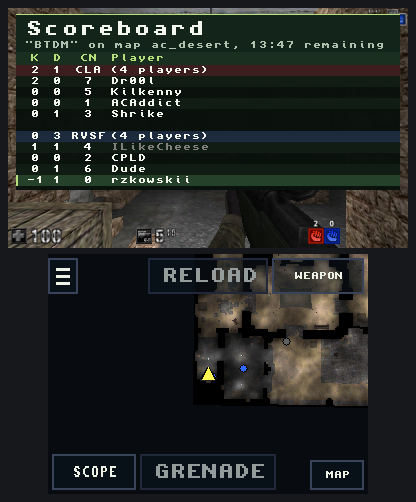 | 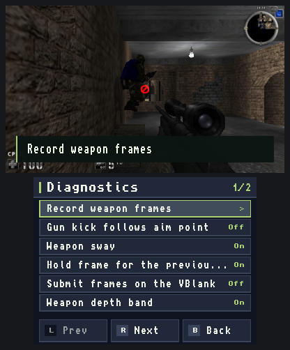 |
| **Scoreboard** · sharp text at native resolution, with paging | **Diagnostics** · frame recorder and rendering switches |

### Menus

| | |
| :---: | :---: |
| 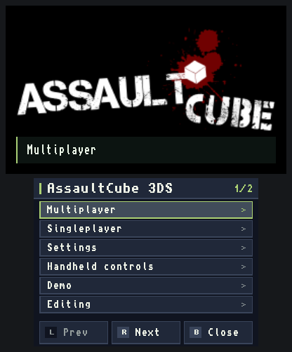 | 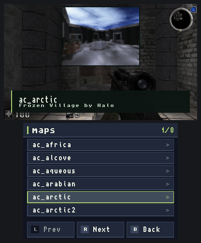 |
| **Main menu** | **Map browser** · preview on top, list below |
|  | 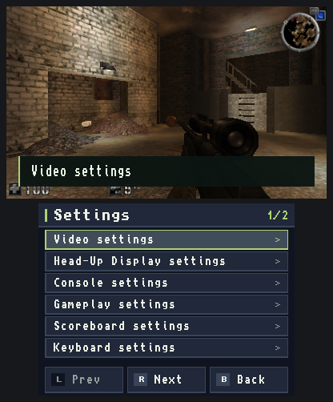 |
| **Server browser** · public servers, one large JOIN | **Settings** |
| 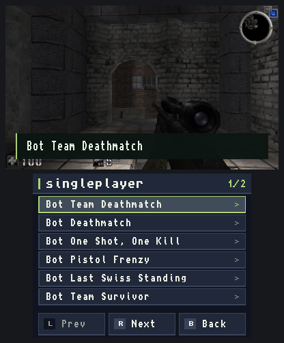 | 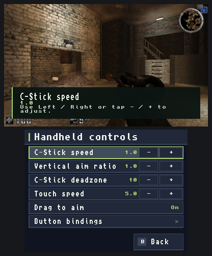 |
| **Singleplayer** · every bot mode | **Handheld controls** · aiming and button bindings |

## Get it on your 3DS

### What you need

- A **New Nintendo 3DS, New 3DS XL or New 2DS XL**. The original 3DS, 3DS XL and 2DS are not supported: the port needs the New models' extra memory and CPU.
- The **Homebrew Launcher**, for example through [Luma3DS](https://github.com/LumaTeam/Luma3DS). If your console is not set up for homebrew yet, follow <https://3ds.hacks.guide> first. The game is a `.3dsx`. **A `.cia` is not provided**, and the builder cannot make one.
- For sound, **`/3ds/dspfirm.cdc`** on the SD card, the usual DSP firmware dump from your own console (Luma3DS: hold L + Down + Select, then Miscellaneous options, Dump DSP firmware). Without it the game runs silently. [Audio notes](docs/audio-3ds.md)
- About **70 MB free** on the SD card.

The release here is the game engine only, about 4 MB. AssaultCube's own files (maps, textures, models, sounds) come from the official AssaultCube download, by one of the four routes below. [Why it works this way.](#licensing-and-what-is-distributed)

### Route 1: let the console download the game data

The shortest route. You need Wi-Fi on the console.

1. Download the latest `AC-3DS0v….zip` from [Releases](https://github.com/rzkowskii/AC3DS/releases) and unzip it. You need `AC-3DS0v1.14` (build 26) or later; the v1.0 engine does not have the download.
2. Copy its `assaultcube.3dsx` to the SD card as `/3ds/assaultcube/assaultcube.3dsx`. Create the `assaultcube` folder if it is not there.
3. Put the card back, connect the console to Wi-Fi and open **AC-3DS0v1.14** in the Homebrew Launcher (the title carries the version).
4. The touch screen says that no game data was found and offers to fetch it. Press **A**.
5. Wait for the progress page to finish. The game starts by itself.

<p align="center">
  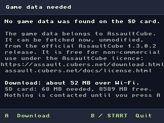
  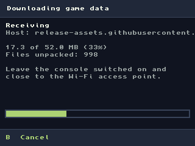
</p>

What happens in step 5: the console downloads the official AssaultCube 1.3.0.2 package (about 52 MB) straight from [AssaultCube's own release](https://assault.cubers.net/download.html), checks its size and SHA-256, and unpacks the game's data folders into one file, `/3ds/assaultcube/assets.romfs`. Nothing is contacted before you press A. **B** cancels at any time and leaves nothing half-installed.

How long it takes on a console is not measured yet for this build. Build 24 took about 31 minutes on my New 2DS XL because it wrote 1,979 separate files; build 26 writes one file and should be much quicker (74 seconds in the emulator, which says little about a real SD card). Leave the console on its charger and let it run. [What is fetched, verified and written](docs/first-run-download.md)

### Route 2: build one file in your browser

No Wi-Fi on the console, or you would rather copy a single finished file. The builder is a web page that joins the engine and the official package **on your own computer**. Nothing is uploaded and nothing is installed.

1. Download this repository (green **Code** button, **Download ZIP**) and unzip it, or clone it.
2. Download the latest `AC-3DS0v….zip` from [Releases](https://github.com/rzkowskii/AC3DS/releases) and unzip it to get the engine, `assaultcube.3dsx`.
3. Download the official [AssaultCube v1.3.0.2 Lockdown Edition RC1 `.tar.bz2`](https://github.com/assaultcube/AC/releases/download/v1.3.0.2/AssaultCube_v1.3.0.2_LockdownEdition_RC1.tar.bz2) (the Linux package on the [AssaultCube download page](https://assault.cubers.net/download.html); it is the right file on Windows and macOS too). Do not unpack it.
4. Open `tools/builder/index.html` from the repository folder in your browser. Double-clicking it is enough: it is made to work straight from disk. I have tested it in Chrome and Firefox served from a local web server; if your browser refuses to run it from disk, run `python3 -m http.server --directory tools/builder` and open <http://localhost:8000/>.
5. Drop both files, the `.tar.bz2` and the engine `assaultcube.3dsx`, anywhere on the page.
6. Press **Build assaultcube.3dsx** and wait for the bar to finish.
7. Press **Save assaultcube.3dsx**. The saved file is about 64 MB.
8. Copy it to the SD card as `/3ds/assaultcube/assaultcube.3dsx` and open **AC-3DS0v…** in the Homebrew Launcher.

| | |
| :---: | :---: |
| 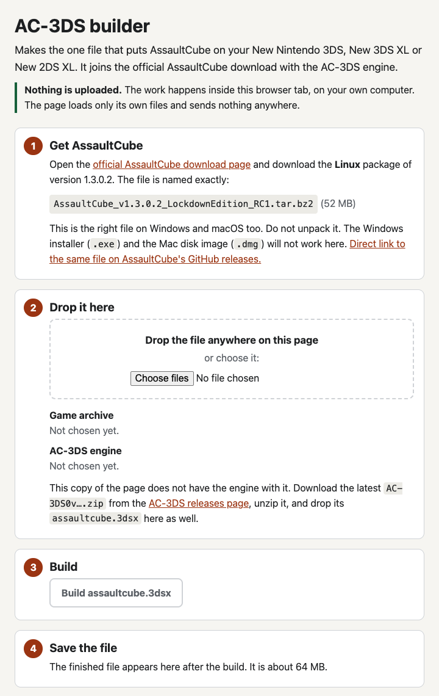 | 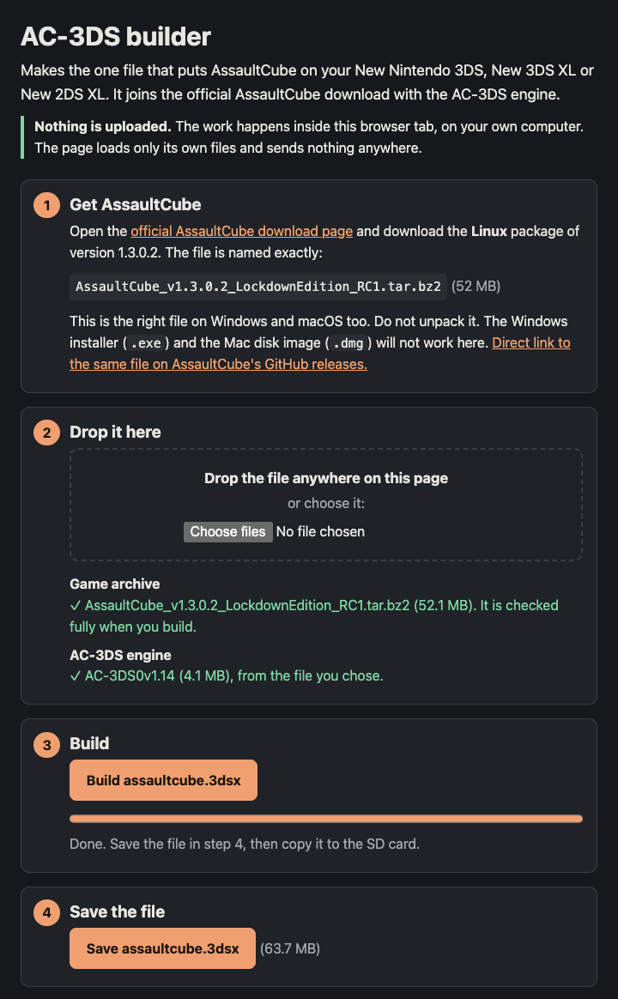 |
| The page as it opens | After a build, in dark mode |

The page refuses anything but the unchanged official archive (it checks the size and SHA-256) and an engine-only AC-3DS file, and tells you which file it wanted. **The built file contains AssaultCube's media, so it is for your own console: do not share or upload it.** When a new AC-3DS release comes out, build again with the new engine; copying a release's small `assaultcube.3dsx` over a built one removes the game data from it. [How the builder works](docs/builder.md)

### Route 3: build one file from the command line

The same result as the web page, byte for byte, with only Python 3.

1. Get the repository, the engine and the official archive as in steps 1 to 3 of route 2.
2. From the repository folder, run (on Windows, `py` instead of `python3`):

   ```sh
   python3 scripts/make-3dsx.py AssaultCube_v1.3.0.2_LockdownEdition_RC1.tar.bz2 assaultcube.3dsx out/assaultcube.3dsx
   ```

   The first argument is the official archive, the second the engine from the release, the third the file to write.
3. Copy `out/assaultcube.3dsx` to the SD card as `/3ds/assaultcube/assaultcube.3dsx`.

### Route 4: loose files on the SD card

The original route. It needs Python 3 and gives the game the same files as folders.

1. Download the latest `AC-3DS0v….zip` from [Releases](https://github.com/rzkowskii/AC3DS/releases) and unzip it. It contains `assaultcube.3dsx` and `stage-assets.py` (the script is also in this repository as `scripts/stage-assets.py`).
2. Download the official [AssaultCube v1.3.0.2 Lockdown Edition RC1 `.tar.bz2`](https://github.com/assaultcube/AC/releases/download/v1.3.0.2/AssaultCube_v1.3.0.2_LockdownEdition_RC1.tar.bz2). Keep it as it is.
3. Stage the game files (on Windows, `py` instead of `python3`):

   ```sh
   python3 stage-assets.py AssaultCube_v1.3.0.2_LockdownEdition_RC1.tar.bz2 sd-assets
   ```

   The script checks the archive's SHA-256 and copies only the game's data folders (`config`, `packages`, `bot` and so on), leaving out the PC programs and source.
4. Copy the contents of `sd-assets/` and the release's `assaultcube.3dsx` into `/3ds/assaultcube/` on the SD card. You end up with `/3ds/assaultcube/assaultcube.3dsx`, `/3ds/assaultcube/config/`, `/3ds/assaultcube/packages/` and so on.
5. Open **AC-3DS0v…** in the Homebrew Launcher.

With `jpegtran` (libjpeg-turbo) and a C compiler installed, and SDL_image's `stb_image.h` passed with `--stb-image`, the script also converts progressive JPEG textures to baseline, pixel for pixel the same. The game decodes those about twice as fast, so maps load a little quicker than with routes 1 to 3.

### After it starts

Pick **Singleplayer** for a bot match or **Multiplayer** to browse servers. Settings, screenshots, demos and logs live in `/3ds/assaultcube/profile/`, whichever route you took.

To update, replace `assaultcube.3dsx` with the new release's file and keep everything else. The exception is a file made with route 2 or 3: build it again with the new engine.

To remove the game data, delete `/3ds/assaultcube/assets.romfs` (route 1), the built `assaultcube.3dsx` (routes 2 and 3) or the loose folders (route 4). Your profile is not touched.

### Troubleshooting

| What you see | What to do |
| --- | --- |
| AC-3DS0v… is not listed in the Homebrew Launcher | The file must be exactly `/3ds/assaultcube/assaultcube.3dsx`. If the name does not match the folder, the launcher shows a plain folder instead of the game. If your browser saved it as `assaultcube (1).3dsx`, rename it. |
| "No game data was found" and you did not expect it | You copied the small engine file and there is no game data on the card yet. Press A to download it, or use route 2, 3 or 4. This also happens after copying a release's engine over a file built with route 2 or 3. |
| The download stops with a certificate or date message | Set the console's date and time in System Settings. A clock that is far off makes every certificate look expired. |
| The download stops for another reason | The page says why and that nothing was installed. Press A to try again. Check Wi-Fi and that about 70 MB is free. |
| "The game data file is damaged." | Press A to download it again, or delete `/3ds/assaultcube/assets.romfs` and start over. |
| No sound | Put your console's `dspfirm.cdc` in `/3ds/` (see [What you need](#what-you-need)). |
| The builder says a file is the wrong one | It wants the unchanged `AssaultCube_v1.3.0.2_LockdownEdition_RC1.tar.bz2`, 52,071,427 bytes, not the Windows installer or the Mac disk image, and the small engine file from an AC-3DS release. Some browsers unpack `.bz2` downloads; download it again and keep it as it is. |
| The game stops for about two seconds and carries on | See [Known issues](#known-issues). |
| A crash or a freeze | The game writes `crash.txt` or `stall.txt` to `/3ds/assaultcube/profile/`, next to `clientlog.txt`. Please attach them to an [issue](https://github.com/rzkowskii/AC3DS/issues). |

## What's new since v1.0

v1.0 was build 11. This is build 26.

**Features**

- **First-run download.** An engine with no game data offers to fetch the official AssaultCube package on the console, verifies it and unpacks it into one file.
- **One-file builder.** A web page and a matching script that join the engine and the official package on your own computer.
- **Respawn countdown.** Both screens count down after you die, then prompt: press L, or tap the touch screen.
- **Touch weapon picker.** Tap WEAPON and choose your next primary from large tiles.
- **SCOPE button** for the sniper rifle on the touch screen. R still zooms while held.
- **Sharper scoreboard.** Drawn at native resolution in a pixel font, with paging for long lists and the winner on its own line.
- **Release-to-select touch menus.** A row is chosen when you lift the stylus on it; sliding away cancels.
- **Diagnostics menu** in the pause menu, with a frame recorder and switches for faults only the console shows.

**Fixes**

- A startup crash after launching from a HOME Menu shortcut. The likeliest cause, the game being built position-independent by accident, is removed, and the build now refuses to produce such a file.
- A crash in bot matches on maps whose stock waypoint files state a wrong count.
- Running out of memory after many map changes.
- Online map changes that fetch custom content no longer drop the connection. The wait is limited to 30 seconds and START cancels it.
- The server browser's JOIN connects to the server you pressed, even if the list sorts or refreshes under the stylus.
- A match forced to end by the server now goes to intermission at once, and the scope is cleared at match end.
- The touch screen is double-buffered and no longer flashes.
- The fire button respawns you while the scoreboard is open.
- Sound no longer drops out on frames longer than about 20 ms.
- One frame drawn without its facing walls at every death and respawn.

**Performance and stability**

- **Per-pixel fog on the ordinary depth buffer.** Fog is computed from eye distance for every pixel and matches the PC game's falloff, without the depth mode build 11 used for it.
- **Long sessions.** Small allocations come from a dedicated pool and per-map buffers are released at every map change. A 30-map bot rotation completes in the emulator with memory to spare.
- **GPU queue recovery.** If the GPU queue stops advancing, the game clears it after two seconds and carries on instead of hanging.
- **Stall and crash reports.** `crash.txt` and `stall.txt` name the map, the phase, memory and the last log lines, and the five previous reports are kept.
- Less rendering work while standing still online, and in the stencil shadow passes.

**Tools**

- `tools/builder/` and `scripts/make-3dsx.py`: the one-file builder.
- `scripts/symbolize-crash.py`: turns a console `crash.txt` into function names, and checks it is using the right build.
- `scripts/decode-gunburst.py`: turns a frame recording from the Diagnostics menu into pictures.
- `ac3dsbench`: a console command that runs a moving-camera benchmark on the console and logs real GPU times.
- Host tests for the download and the builder (`scripts/qa/firstrun-test.py`, `scripts/qa/check-make-3dsx.py`).

The full account, build by build, is in [Development status](docs/port-status.md).

## Known issues

- **The weapon in hand can ghost or flicker while you move.** On the real console it sometimes looks see-through for a moment as you move and turn. It is most noticeable with the sniper rifle, and it does not show in the emulator. Build 22 changed how the weapon is positioned after a shot and added the Diagnostics page to help track it down. It is not fixed yet. I'm working on it.
- **A rare freeze.** Twice on the console (builds 14 and 22) the GPU queue stopped advancing and the game hung. Since build 23 the game recovers by itself after two seconds instead of hanging. I do not understand the cause yet.
- **The download has not been timed on a console for this build.** Build 24's took about 31 minutes on my New 2DS XL; build 26 writes one file and takes 74 seconds in the emulator, which does not tell you what a real SD card will do.
- **The builder is not tested in Safari**, and a file made by the builder has only been started in the emulator so far.
- **No `.cia`.** The game runs from the Homebrew Launcher.

More detail, and how to send me something useful if you hit one of these: [Known issues](docs/known-issues.md).

## Controls

| Input | In a match |
| --- | --- |
| Circle Pad | Move and strafe |
| C-Stick, or drag on the touch screen | Aim |
| Double-tap the touch screen | Jump |
| L | Fire; respawn when you are dead |
| R | Hold to scope, or the weapon's special action |
| A / B | Jump / knife |
| X / Y | Reload / last weapon |
| ZL / ZR | Quick grenade / crouch |
| D-Pad | Primary / secondary weapon (up / down), previous / next weapon (left / right) |
| START / SELECT | Match menu / hold for scores |
| Touch: RELOAD, GRENADE | Reload, throw a grenade |
| Touch: WEAPON | Choose a primary for your next spawn |
| Touch: SCOPE | Toggle the sniper rifle's zoom |
| Touch: MAP / RADAR | Switch between the radar and the whole map |
| Touch: corner tab | Menu, scores, chat |

Open **Handheld controls** from the main menu to rebind buttons and tune aiming. [Full controls](docs/controls-3ds.md)

## How the port works

AssaultCube targets desktop OpenGL and a mouse. The 3DS has a PICA200 GPU with no fragment shaders, 124 MB of usable memory, an 804 MHz ARM11, two screens and a stylus. The port keeps AssaultCube's game logic and network protocol, changes the engine only where the 3DS needs it, and rebuilds the platform layer around it.

- **Rendering.** An OpenGL 1.x layer on Citro3D drives the PICA200 directly at 400×240. World geometry is drawn in large batches that are reused while the view holds still. Water uses render-to-texture reflection and refraction, characters cast stencil shadows, and fog is computed per pixel with the PICA's procedural texture unit.
- **Loading.** Textures are decoded on two cores at once while a map loads, and sounds are decoded in the background.
- **Two screens.** The match screen is built from the map's own GPU-drawn overview. The radar follows the PC radar's rules: teammates and flags, no opponents.
- **Network.** ENet runs over the 3DS socket service. A helper thread keeps the server connection alive for up to three minutes while the keyboard or HOME menu is open. The console can also run AssaultCube's dedicated server (checked in the emulator only). [Network play and SD storage](docs/network-storage.md)
- **Robustness.** A crash handler and a stall watchdog write reports to the SD card. Settings are written to a temporary file and swapped in, with backups.

| Area | On the 3DS |
| --- | --- |
| Maps and modes | All 44 official maps and all stock modes, including CTF, team modes, one-shot-one-kill and the bot modes |
| Bots | Stock AssaultCube bots with waypoints |
| Online play | Protocol 1300: master list, direct connect, play on public servers, custom map downloads. Favourites, LAN, votes and admin use the stock code and are not yet tested on the console |
| Graphics | Original textures (scaled to 256 px), models, sky boxes, water reflection and refraction, stencil shadows, dynamic lights, PC-style fog |
| Audio | Original sounds and ambience on the 3DS DSP, with distance falloff and stereo panning |
| Editor and demos | Map editor with undo, redo and map saving; demo playback with seeking |
| Input | Circle Pad, C-Stick, touch aim, full button remapping, and the software keyboard for chat and console |
| Not included | Desktop-only options such as resolution, fullscreen, vsync and antialiasing, and the desktop server wizard |

### Measured

| Where | What | Result |
| --- | --- | --- |
| New 2DS XL | CPU clock | 804 MHz mode active |
| New 2DS XL | Map load | `ac_douze` 1.1 s, `ac_dusk` 2.3 s, `ac_arctic2` 2.8 s, `ac_alcove` 3.3 s |
| New 2DS XL | Online CTF on a public server, build 12 | 13 to 17 ms per logged frame |
| New 2DS XL | First-run download, build 24 | Completed and verified; 1,881 s |
| Azahar | First-run download, build 26 | 74 s, one file of 59,588,112 bytes |
| Azahar | `ac_douze`, six bots, camera turning | 59.8 FPS mean, 19.1 ms 99th percentile |
| Azahar | `ac_venison`, eight bots, camera turning | 59.8 FPS mean, 17.5 ms 99th percentile |

Azahar figures are from the emulator in New 3DS mode at its stock CPU clock. It does not model GPU time or SD card speed, so they are not console measurements. [Detailed status](docs/port-status.md) · [Emulator test fixtures](docs/emulator-qa.md) · [3DS hardware notes](docs/3ds-hardware.md)

## Build from source

You need [devkitPro's 3DS tools](https://devkitpro.org/wiki/Getting_Started): devkitARM, libctru, Citro3D, Picasso, 3dsxtool and smdhtool, and the 3DS portlibs for zlib, Tremor, Ogg, Mbed TLS 2.28 (`3ds-mbedtls`) and bzip2 (`3ds-bzip2`). On the host you need Git, CMake 3.20 or later and Python 3. Set `DEVKITPRO` to the SDK root. CMake downloads the pinned SDL2 and SDL2_image sources on the first configure.

```sh
git clone https://github.com/rzkowskii/AC3DS.git
cd AC3DS
```

**Engine only**, the file that goes in a release. It contains no game data and offers the first-run download:

```sh
cmake -S . -B build-release \
  -DCMAKE_TOOLCHAIN_FILE=cmake/arm-3ds.cmake \
  -DCMAKE_BUILD_TYPE=Release \
  -DAC3DS_EMBED_ASSETS=OFF
cmake --build build-release --parallel 4
```

**With the game data embedded** from your own copy of the official archive. One file, for your own console only:

```sh
cmake -S . -B build-3ds \
  -DCMAKE_TOOLCHAIN_FILE=cmake/arm-3ds.cmake \
  -DCMAKE_BUILD_TYPE=Release \
  -DAC3DS_ASSET_ARCHIVE="$HOME/Downloads/AssaultCube_v1.3.0.2_LockdownEdition_RC1.tar.bz2"
cmake --build build-3ds --parallel 4
```

Either way the result is `assaultcube.3dsx` in the build folder; copy it to `/3ds/assaultcube/assaultcube.3dsx`. Keep the `assaultcube.elf` beside it if you want to read a crash report later.

| Option | Default | Meaning |
| --- | --- | --- |
| `AC3DS_EMBED_ASSETS` | `ON` | Put the game data inside the `.3dsx`. Needs `AC3DS_ASSET_ARCHIVE`. |
| `AC3DS_ASSET_ARCHIVE` | empty | Path to the official `AssaultCube_v1.3.0.2_LockdownEdition_RC1.tar.bz2`. |
| `AC3DS_FIRSTRUN` | `ON` | Include the first-run download. `OFF` builds without Mbed TLS and bzip2. |

The launcher title comes from the `RELEASE_NAME` file and the build number from `BUILD_NUMBER`. [Build notes](docs/sdk-build.md)

## Licensing and what is distributed

**This project distributes the engine only.** The repository holds the source, and each release adds an engine-only `assaultcube.3dsx` with no maps, textures, models, sounds or configuration in it. I do not distribute a `.cia`, a `.3ds`, or any file with AssaultCube's game data inside.

The reason is AssaultCube's [licence](https://assault.cubers.net/docs/license.html) ([copy in this repository](docs/upstream/license.html)). As I read it, AssaultCube's media may be redistributed only as the unmodified official package, and a 3DS package with the media inside would be a modified one. So the game data always comes from the official package, on your side:

- **The first-run download** runs on your own console, after you press A. The game fetches the official AssaultCube 1.3.0.2 package from AssaultCube's own release on GitHub ([assaultcube/AC](https://github.com/assaultcube/AC/releases/tag/v1.3.0.2), the file the [AssaultCube download page](https://assault.cubers.net/download.html) offers for Linux), checks its size and SHA-256 against values compiled into the program, and unpacks it locally. Your console downloads the same file a PC player would. Nothing from the package is hosted, mirrored, modified or redistributed by this project.
- **The builder and the scripts** run on your own computer, on the copy of the official package you downloaded yourself. They check the same size and SHA-256. Nothing is uploaded.
- **What ends up on your SD card** (`assets.romfs`, a built `assaultcube.3dsx`, or the loose folders) contains AssaultCube's media. It is for your own console. Do not share it.
- **It is the same game.** Stock 1.3.0.2 rules, physics, netcode and protocol. The changes are platform ones: OpenGL translated to the 3DS GPU through Citro3D, NDSP audio, button and touch input, and memory and loading work to fit the console. There is no aim assist or anything else gameplay-side, in line with the fair-play note in [source/README.txt](source/README.txt).
- **Free and unofficial.** AC-3DS is free and non-commercial. It is not affiliated with or endorsed by the AssaultCube team or Nintendo.

If you are from the AssaultCube team and read any of this differently, or want something changed (the name, the screenshots, the download, anything), open an issue and I will fix it.

## Documentation

- [Known issues](docs/known-issues.md)
- [Controls and remapping](docs/controls-3ds.md)
- [First-run download of the game data](docs/first-run-download.md)
- [One-file builder](docs/builder.md)
- [Network play, hosting a server, and SD storage](docs/network-storage.md)
- [Audio and DSP setup](docs/audio-3ds.md)
- [Building from source](docs/sdk-build.md)
- [3DS hardware notes](docs/3ds-hardware.md)
- [Development status and measurements](docs/port-status.md)
- [Emulator test fixtures](docs/emulator-qa.md)
- [Upstream release provenance](docs/release-evidence.md)
- [Third-party notices](docs/third-party-notices.md)

## Credits

AC-3DS is a port by [rzkowskii](https://github.com/rzkowskii).

AssaultCube was created by Rabid Viper Productions and its contributors, building on the Cube engine by Wouter van Oortmerssen. All credit for the game, its maps and its media is theirs: [assault.cubers.net](https://assault.cubers.net/).

- **Source code.** AssaultCube's source is under its zlib-style licence, which this repository keeps ([source/README.txt](source/README.txt), [source/README_CUBEENGINE.txt](source/README_CUBEENGINE.txt)). ENet, SDL, libctru, Citro3D, Tremor, zlib, Mbed TLS and bzip2 keep their own licences ([third-party notices](docs/third-party-notices.md)).
- **Game content.** Maps, textures, models and sounds are not in this repository or its releases. They come from your own copy of the official package, under [AssaultCube's terms](https://assault.cubers.net/docs/license.html). AssaultCube is freeware and may not be used commercially.
