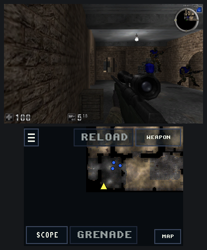
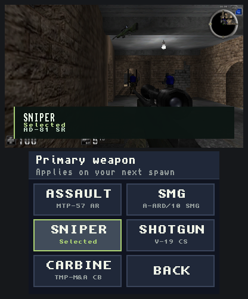
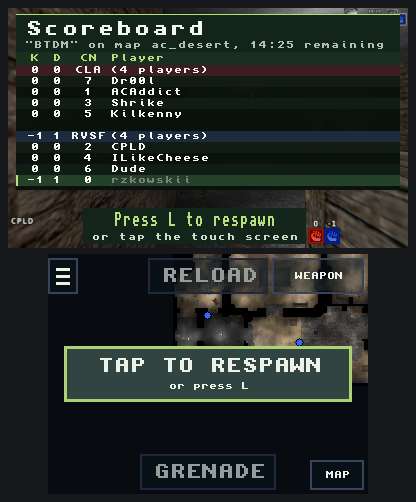
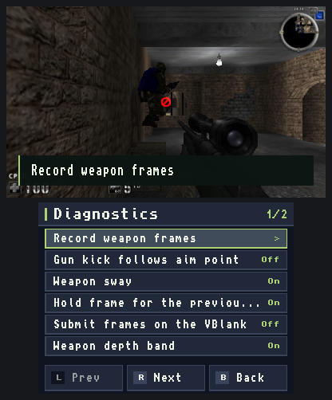

# New Nintendo 3DS and New Nintendo 2DS XL controls

This page describes build 26 (`AC-3DS0v1.14`). The pictures are from the Azahar emulator at native resolution, top screen above touch screen.

| | |
| :---: | :---: |
|  |  |
| The match screen with the sniper rifle equipped | The weapon picker |

The top screen shows the match, menu details and map previews. The touch screen shows the active menu or match controls. The server browser lists servers on the top screen, one row each with ping, players, name and map, and shows the selected server's mode, map, time left and address underneath. The touch screen shows that server as a card, with a large JOIN button, scroll arrows that repeat while held, and SCAN (refresh the list), FILTER (responding servers only), SORT (next sort column) and BACK. The touch screen keeps showing the target server while you hold JOIN. Lift the stylus inside JOIN to connect, or slide away to cancel.

| Control | In a match | In the map editor |
|---|---|---|
| Circle Pad | Move and strafe | Move and strafe |
| C-Stick or drag the upper touch area | Aim | Look and position the selection cursor |
| A / B | Jump / knife attack | Fly up / down |
| L | Fire; respawn when you are dead | Hold and drag to select |
| R | Hold to scope with the sniper rifle, special action with other weapons | Editing tools |
| ZL / ZR | Quick grenade / crouch | Edit modifier / secondary edit modifier |
| X / Y | Reload / previous weapon | Copy / paste |
| D-Pad Up / Down | Primary / secondary weapon | Raise / lower floor |
| D-Pad Left / Right | Previous / next weapon | Decrease / increase the active editing value |
| START | Open the match menu | Open the match menu |
| SELECT | Hold for scores | Editing tools |

During a demo, D-Pad Up and Down adjust playback speed. In spectator mode, weapon cycling follows the original spectating controls.

When you die, a banner at the bottom of the top screen says what happens next. It counts down (**Respawn in 2**; five seconds in flag modes) and then reads **Press L to respawn**, with *or tap the touch screen* under it. It names whichever button fire is bound to. The touch screen shows a wide RESPAWN button across the map with the same countdown; it lights up as **TAP TO RESPAWN** when you can spawn. Both do the same thing as releasing the fire button, and both work while the scoreboard that opens on death is showing; the scoreboard moves up to leave room for the banner. Pressing or tapping too early turns the banner red for a moment and does nothing else. In survivor and the other round-based modes nothing respawns you: the banner reads **Round in progress** until the round ends and then counts down **Next round in 5**. On a spectator team it reads **Press L to join**. With the scoreboard closed, the dead view also names the button that changes the view (A by default; a double-tap on the map does the same) and, online, the buttons that change the followed player (D-Pad Left/Right). `hidespecthud 1` hides the banner and these hints; the RESPAWN button stays.

The top-screen scoreboard uses a crisp pixel font with a high-contrast background and a page counter for longer lists. When the columns need more space, a player's scores continue on the next line. The winner or tie appears on its own line at the end of a match. While the scoreboard is showing, L, R, ZL and ZR turn the page and keep their match actions.

During play, the lower screen is the match screen. The map fills the whole screen. Drag across it with the stylus to look around, and double-tap it to jump (the second tap can keep dragging to aim). By default it is a close radar that rotates so forward is up, showing you, your teammates in team modes and flags. The MAP button in the bottom-right corner switches to the whole map, north up, with your position as an arrow; tap RADAR to switch back. RELOAD sits at the top centre and GRENADE at the bottom centre, as translucent buttons that dim when they have nothing to do. RELOAD lights while you reload. The small tab in the top-left corner slides out a drawer with MENU (the match menu, also START), SCORES (hold it, or SELECT) and CHAT. Tap anywhere outside the drawer to close it. During a vote, VOTE YES and VOTE NO appear under RELOAD. While you are dead or spectating, RESPAWN sits across the middle of the map, under the vote buttons; the rest of the map still drags the view. While you have the sniper rifle equipped, tap **SCOPE** at bottom left and lift the stylus to zoom in. Tap **UNSCOPE** to clear the touch zoom. Sliding off the button cancels the tap. R keeps the scope zoomed while held, and releasing it leaves touch zoom in effect if enabled. Close the drawer to use the touch Scope button. Voice commands, voting, the full map, flag drop, the weapon picker, screenshots, map editing and the Diagnostics page are in the match menu. The editor replaces the match screen with editing tools, undo, redo, previous and next values, deleting an entity, and exiting edit mode. Offline matches pause while the START menu is open. Choose **Resume match** or press B or START to close it. Online, START opens a match menu that does not pause, because the match keeps running on the server. It has chat, team chat, voice commands, voting, the full map, flag drop, weapons, scores, the server and team menu (the standard in-game or admin menu), handheld controls, settings, the command line and disconnect. Map editing is only in the offline menu. **Toggle full map** switches the overview on or off until you choose it again. During a demo, or before a map has loaded, START opens the standard menu.

Tap **WEAPON** beside RELOAD to choose your next primary. Lift the stylus inside the chosen tile to confirm, or slide off the tile to cancel. You can also use the D-Pad and A. A mode with a fixed loadout applies its own weapon rules and saves your preference for modes that let you choose. BACK, B and START return to the previous screen.

The match menus have a **Diagnostics** page for faults that only show on a console ([known issues](known-issues.md)). **Record weapon frames** counts down three seconds and saves a short run of top-screen frames to `gunburst_N.bin` in the profile folder; `scripts/decode-gunburst.py` turns the file into pictures. The switches below it (gun kick follows aim point, weapon sway, hold frame for the previous one, submit frames on the VBlank, weapon depth band, weapon fog stage) change how the weapon and the frame are drawn. None is saved: every launch starts from the defaults, so they cannot leave the game in an odd state.

| | |
| :---: | :---: |
|  |  |
| Respawn prompt on both screens | The Diagnostics page |

Lift the stylus inside a menu row to select it. Sliding away cancels the selection. You can also use the D-Pad or Circle Pad and press A. Adjust sliders with Left/Right or the on-screen −/+ buttons. Use L/R, ZL/ZR or the touch footer to change pages. B or START goes back. X opens the keyboard on a text field or refreshes the current server view. Y saves a screenshot. In the server browser, hold SELECT for the ten favorite group shortcuts and use D-Pad Left/Right to change the sort column.

Public chat, team chat, and the command prompt open the Nintendo software keyboard with the current text. Cancel returns to the command line so you can inspect history or edit the draft. X reopens the keyboard, A submits, and B or START cancels. The touch panel also provides history, cursor, completion, help, delete, submit, and cancel controls. For a menu text field, A or X opens the keyboard.

Open **Handheld controls** from the main menu or the match menu to tune aim and remap common actions. **Button bindings → All binding menus** opens the full set. Select an action and press and release the new button. START cancels capture. Rebinding changes only the physical buttons; the lower-screen touch buttons keep their actions. **Full map (hold)** shows the overview while its button is held. You can also remap in `config/autoexec.cfg` inside the SD profile. The key names use the `3DS_` prefix, for example `bind 3DS_ZR reload`, `editbind 3DS_CPAD_UP forward`, or `specbind 3DS_UP speckey_demo_gamespeedup`. The full set is:

```text
3DS_A 3DS_B 3DS_X 3DS_Y 3DS_L 3DS_R 3DS_ZL 3DS_ZR
3DS_START 3DS_SELECT 3DS_UP 3DS_DOWN 3DS_LEFT 3DS_RIGHT
3DS_CPAD_UP 3DS_CPAD_DOWN 3DS_CPAD_LEFT 3DS_CPAD_RIGHT
3DS_TOUCH_CHAT 3DS_TOUCH_TEAM 3DS_TOUCH_CONSOLE 3DS_TOUCH_EDIT
3DS_TOUCH_VOICE 3DS_TOUCH_MAP 3DS_TOUCH_YES 3DS_TOUCH_NO
3DS_TOUCH_FLAG 3DS_TOUCH_SCREENSHOT 3DS_TOUCH_WEAPONS
3DS_TOUCH_NEXT 3DS_TOUCH_PREV 3DS_TOUCH_UNDO 3DS_TOUCH_REDO
3DS_TOUCH_DELETE 3DS_TOUCH_EDITMENU
3DS_TOUCH_RELOAD 3DS_TOUCH_GRENADE 3DS_TOUCH_SCOPE 3DS_TOUCH_WEAPON
3DS_TOUCH_MENU 3DS_TOUCH_SCORES 3DS_TOUCH_JUMP 3DS_TOUCH_RESPAWN
```

The visible WEAPON button uses `3DS_TOUCH_WEAPONS`. The older `3DS_TOUCH_WEAPON` cycle binding is retained for existing profiles. The SCOPE button uses `3DS_TOUCH_SCOPE` with the default action `ac3ds_scope_toggle`.

`csticksensitivity` adjusts C-Stick turn speed. `cstickysensitivity` adjusts its vertical speed relative to horizontal speed, and `cstickdeadzone` sets how much movement the stick needs before it turns the camera. `touchaim` enables touchscreen aiming on the radar, and `touchsensitivity` adjusts how far the view turns as you drag. `doubletapjump 0` turns off double-tap to jump, and `doubletapms` sets how quickly the second tap must follow, from 150 to 600 ms (default 300). `hudtextscale` sets the size of the top screen's console text from 100 to 300 percent (default 180). Set it to 240 or above for taller scoreboard rows. The original sensitivity, scope sensitivity, and invert settings also apply. Settings and screenshots are stored under `sdmc:/3ds/assaultcube/profile` by default.

The Circle Pad maps to AssaultCube's four movement commands, with diagonal movement when two are held. Explicit bindings in an existing profile take priority over the new defaults.
