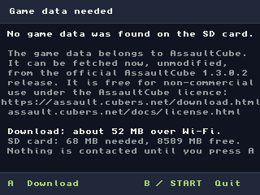
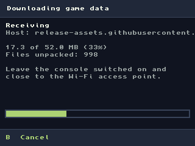
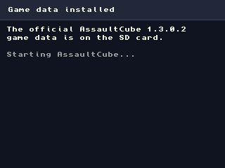

# First-run download of the game data

The released `assaultcube.3dsx` is the engine only. AssaultCube's maps, textures, models, sounds and configuration may be redistributed only inside the unmodified official package ([license](upstream/license.html)), so this project does not ship them, host them or mirror them. When the engine starts and finds no game data, it offers to fetch the official package itself, straight from the AssaultCube release, and to unpack what the game needs into one file on the SD card, `/3ds/assaultcube/assets.romfs`. The project redistributes nothing: the console downloads the same file a PC user would.

The manual route still works and gives the game the same files: stage the archive on a computer with `scripts/stage-assets.py` and copy the folders to the SD card ([README](../README.md#get-it-on-your-3ds)).

## What the player sees

| | | |
| :---: | :---: | :---: |
|  |  |  |
| The offer | The transfer | The result |

All three are the touch screen of build 26 in Azahar, fetching from the official address.

The game takes its data from the first of three places that has it (it looks for `config/font.cfg` and `packages/misc/notexture.jpg`): the `.3dsx` itself (RomFS, an asset-embedded build), the file `sdmc:/3ds/assaultcube/assets.romfs`, or loose `config` and `packages` folders in `sdmc:/3ds/assaultcube/`. The offer appears only when none has it. A build or SD card that already has the data starts exactly as before, and that includes a card with loose folders from a manual installation or from the download of build 24: they are read where they are and never converted or touched.

1. **Offer.** The lower screen says that the game data is AssaultCube's, that it is fetched unmodified from the official AssaultCube 1.3.0.2 release and is free for non-commercial use under the AssaultCube licence, and names <https://assault.cubers.net/download.html> and the licence page. It shows the download size (about 52 MB), the SD card space needed and free, and that Wi-Fi is needed. **A** downloads; **B** or **START** quits. Nothing is contacted before A is pressed.
2. **Download.** A progress page shows the step, the host, megabytes received, a percentage and the number of files unpacked. **B** cancels at any time. HOME and sleep are held off while the transfer runs, as they are for a hosted server, because either would drop the connection; closing the lid does not stop it.
3. **Result.** On success the game starts straight away, with no relaunch. On a failure or a cancel the page says what went wrong and that nothing was installed; **A** tries again, **B** or **START** quits.

## What is fetched, and from where

| | |
| --- | --- |
| File | `AssaultCube_v1.3.0.2_LockdownEdition_RC1.tar.bz2`, the Linux package of the official v1.3.0.2 release |
| Address | `https://github.com/assaultcube/AC/releases/download/v1.3.0.2/AssaultCube_v1.3.0.2_LockdownEdition_RC1.tar.bz2` |
| Size | 52,071,427 bytes |
| SHA-256 | `9b3118e7929253f0114fa06cad8310faab646d177b4660406011152f34086b55` |

GitHub answers that address with a redirect to its release storage on a `githubusercontent.com` host; the download follows up to three redirects, and only to `github.com` or a `githubusercontent.com` host on port 443. The size and hash are the ones `scripts/stage-assets.py` already pins. They are compiled into the program; nothing on the SD card or the network can change them in a release build.

The request carries the path, the host name, `User-Agent: AC3DS` and nothing else: no console identifiers, no account, no cookies.

## What is verified

- **Each server.** TLS 1.2 through Mbed TLS (the console's own TLS library stops at 1.1), with server name indication, forward-secret AEAD cipher suites only, and certificate verification that cannot be skipped. Each host's certificate must name that host and chain to one of six roots compiled into the program (`source/3ds/firstrun_roots.h`: USERTrust ECC and RSA, Sectigo E46 and R46, ISRG Root X1 and X2). The console's certificate store is not used. The random numbers come from the system (`ps:ps` and `ssl:C`); if neither answers, no connection is made.
- **The response.** Headers over 16 KB are refused. The final response must be a `200` that declares exactly 52,071,427 bytes before the first byte arrives; a chunked or compressed response is refused.
- **The archive.** The SHA-256 of the compressed bytes is computed as they arrive and compared with the pinned value once the last byte is in, together with the size. The bzip2 stream and the tar inside it must both end properly.
- **The contents.** The same rules as `scripts/stage-assets.py`: only `config`, `packages`, `bot`, `mods`, `demos`, `docs` and `screenshots` are unpacked; any member anywhere in the archive with an absolute path or a `..` component stops the installation; under those folders only regular files and directories are accepted (a link, device or FIFO stops it); a name is taken once, and a name that is both a file and a folder stops it. In addition, names the SD card's FAT file system could not hold, components over 100 characters and paths over 200 are refused, and the tar is capped at 160 MB and 8,000 files. GNU long-name records and pax `path`/`size` records are understood (the official archive uses neither). Six files must exist afterwards: `config/font.cfg`, `config/configtemplates.zip`, `config/mapmodelattributes.cfg`, `packages/misc/notexture.jpg`, `packages/misc/icon.png` and `docs/license.html`.

The clock matters: a console whose date is far off sees every certificate as expired or not yet valid, and the page says to check the date and time in System Settings.

## What ends up on the SD card

One file. The archive is never stored: its bytes go from the connection through the hash, the bzip2 decoder and the tar reader into `sdmc:/3ds/assaultcube/assets.romfs.part`, 256 KiB at a time, with about 5.5 MB of working memory, all of it released before the game starts.

- The file is a RomFS image, the format an asset-embedded `.3dsx` carries its data in. The game mounts it with libctru's `romfsMountFromFile` under the same device name, so every path is `romfs:/...` and the game reads its data exactly as the asset-embedded build does.
- File data is written in the order the archive delivers it, each file padded to 4 bytes. The names and offsets (2,460 entries for the release) are kept in memory and written after the data as the four RomFS tables, followed by a 72-byte end mark with the image length, checksums of the header and the tables, the file and folder counts and the SHA-256 of the archive the image was made from. The RomFS header at the start of the file is zero until all of that is on the card; it is written last. libctru finds the tables through the header and does not mind where they are.
- Only when the whole archive has arrived, the size and SHA-256 match, the bzip2 stream and the tar ended properly and the six required files are in the image is the file completed, flushed, closed and renamed to `assets.romfs`. The rename is the installation. There is no other state: no staging folder, no marker file, nothing to move.

For the official release the image is 59,588,112 bytes: 59,446,369 bytes in 1,979 files and 480 folders, the same files byte for byte as `stage-assets.py` stages without its optional JPEG conversion. Mounting it keeps the four tables in memory, 139,088 bytes for the release. The progressive-to-baseline JPEG conversion is a desktop-only step; the game's JPEG decoder handles baseline files roughly twice as fast, so a card staged on a computer with `jpegtran`, or an asset-embedded build, loads maps noticeably faster than console-downloaded data.

Why one file: on a New 2DS XL, build 24 unpacked the release into 1,979 loose files and took 1,881 s, of which 1,416 s were calls to the SD card (about 0.7 s for each file created), 377 s decoding and hashing and about 84 s network. The cost of the card is per call, not per byte. One file is written with about 230 calls instead of several thousand.

To remove the game data, delete `/3ds/assaultcube/assets.romfs`; the next start offers the download again. To replace it, delete it and download again, or put loose folders or an asset-embedded `.3dsx` in its place. Settings, saved games and downloaded maps live in `/3ds/assaultcube/profile/` and are not part of the file. The file is the unmodified release's content in another container; like the folders or a built `.3dsx`, it is for your own console and is not to be shared.

What the game checks before it uses the file, at every start: the length recorded in the end mark, the header and table checksums, that every file's data lies inside the image, and that the two files it looks for are there. This reads the header, the end mark and the tables, not the 59 MB of file data. A file that fails is not mounted and not deleted: with loose folders also on the card the game uses those (the log line `game data:` says so); otherwise the offer appears, headed "The game data file is damaged.", and a completed download replaces the file. An engine-only build made with `-DAC3DS_FIRSTRUN=OFF` names the file and asks for it to be deleted instead. Damage inside a file's data, which the SHA-256 covered when it was downloaded, is not looked for again at each start, as it is not for loose files.

What happens when it does not finish:

| Event | State left | Next launch |
| --- | --- | --- |
| B pressed, network error, timeout, refused certificate or redirect, wrong size or hash, damaged archive, SD write error, card full | `assets.romfs.part` deleted before the result page | Offers the download again |
| Power lost or program closed at any point before the rename | `assets.romfs.part` | Deletes it, then offers the download again |
| Power lost after the rename | `assets.romfs`, complete | Game starts |

A damaged `assets.romfs` that is being replaced stays on the card until the new one is complete, so both need room for a moment. Free space is checked before anything is contacted: the image size plus 8 MB, in whole clusters (about 68 MB).

## Two threads

Receiving, TLS, the SHA-256, the display and the buttons stay on the main thread. The bzip2 decoder, the tar reader and the writes to the SD card run on a second thread on core 2, the core the game uses for texture loading, fed through a 1 MiB buffer in memory; when the buffer is full the main thread waits, still serving the display and B. If that thread cannot be created, the main thread does everything, as build 24 did. B, an error on either side and the console closing the program each stop both sides, and the main thread waits for the other to return before it touches the file again.

`sdmc:/3ds/assaultcube/profile/firstrun.log` records the last attempt: hosts, HTTP statuses, handshake times, byte and file counts, the error text, and where the time went: the whole transfer; on the main thread the SHA-256, the time spent waiting for the unpacker, drawing, and the rest, which is network and TLS; on the unpacking thread the decoding, the number and total time of the SD card writes and the time spent waiting for data; and the time to write the tables, flush and rename. It holds nothing about the console or its owner.

Timeouts: 10 s for a name lookup, 10 s to connect, 30 s for a TLS handshake, 20 s without a byte arriving, one hour overall. The display and the B button are served between every network step and, on a console without the second thread, between every block decoded.

## Building

The first-run download is part of every build by default and links Mbed TLS 2.28 and bzip2 from the devkitPro portlibs (`3ds-mbedtls`, `3ds-bzip2`). `-DAC3DS_FIRSTRUN=OFF` leaves it, and both libraries, out; such a build still reads `assets.romfs` and loose folders, and shows the old "assets were not found" message when it finds neither. The download adds 408,188 bytes to the engine-only `assaultcube.3dsx` of build 25 (3,727,772 to 4,135,960), and the game's heap limit is smaller by about the same amount.

## Testing

`python3 scripts/qa/firstrun-test.py --archive AssaultCube_v1.3.0.2_LockdownEdition_RC1.tar.bz2` builds the portable half (`source/3ds/firstrun_core.cpp` and `romfs_image.cpp`) for the host and checks the hash, address and header parsing, the path rules, unusual and hostile archives, and the image: it is read back with the reader in `scripts/qa/check-make-3dsx.py`, which follows libctru's `romfs_dev.c` (hash lookup, then sibling chains), and must hold exactly the tree `stage-assets.py` produces from the official archive. It also cuts, extends and changes bytes of good images and expects the launch check to refuse every one.

For the console half there is a test switch that a release cannot carry. Configuring with `-DAC3DS_FIRSTRUN_TEST=ON` is refused unless `-DAC3DS_PRODUCTION=OFF` is also given, and the source refuses to compile with both `AC3DS_FIRSTRUN_TEST` and `PRODUCTION` defined. Only such a development build reads `sdmc:/3ds/assaultcube/firstrun-test.cfg`:

```text
url=https://localhost:8443/ok     another archive; its host may then be contacted
sha256=<64 hex digits>            the hash that archive must have
size=<bytes>                      and its length
auto=accept                       answer the offer without a button press (or: quit)
cancel_at=<bytes>                 press B once that much has arrived
shots=1                           save each page to profile/firstrun-*.bmp
worker=0                          unpack on the main thread, as on a console without a free core
```

and trusts one more root from `firstrun-test-root.pem` beside it. `scripts/qa/firstrun-server.py OUT` serves a stand-in archive over HTTPS on `localhost` with a throwaway certificate authority, and writes both files for each scenario (`ok`, `redirect`, `wrong-hash`, `404`, `truncated`, `stall`, `short`) under `OUT/`; pass them to `scripts/run-azahar.py` with `--sd-file`. The scenarios also cover a redirect to another host (`away`), a redirect to plain http (`downgrade`), a certificate from an unknown authority (`untrusted`) and a certificate for another name (`wrong-name`).

## Test status

This section describes build 26 (`AC-3DS0v1.14`). The open points are summarised for players in [known issues](known-issues.md).

The one-file layout has been run on the host and in Azahar. **It has not been run on a console.** The only console run of the download is build 24's, into loose folders, on a New 2DS XL: it installed a working game and took 1,881 s (see above). Azahar's timings say nothing about a New 3DS: its SD card and CPU costs are the emulator's, and its SD card writes are nearly free where the console's are the main cost.

Host (macOS, `scripts/qa/firstrun-test.py`): the self-test; 3 unusual archives in 5 chunk sizes each, every image read back through the libctru-style reader; 29 hostile or damaged archives, each refused and leaving no file; the official archive, whose image holds the same 1,979 files and 480 folders as `stage-assets.py` stages, compared by SHA-256, and was written in 228 blocks of at most 256 KiB; and 392 damaged copies of each of four images (cut short, extended, every header byte, the end mark, 300 places in the tables), every one refused by the launch check. A changed byte inside file data is not detected by that check, by design.

Azahar 2126.2, New 3DS mode, the build 25 tree with this change:

| Run | Build | Result |
| --- | --- | --- |
| Empty SD, offer accepted, official address | development (`auto=accept`) | github.com answered 302, release-assets.githubusercontent.com 200, both over TLS 1.2 and verified against the pinned roots. 52,071,427 bytes, SHA-256 matched, one file of 59,588,112 bytes on the card, byte for byte the image the host test makes. The game mounted it without a relaunch and loaded three maps. 74 s of emulated time from A to installed, three runs alike (the loose-folder layout of build 25 took 172 s in the same emulator): the transfer took 72 s, in which the main thread spent 14 s hashing, 44 s waiting for the unpacker and 13 s on network and TLS; core 2 spent 73 s decoding and 14 ms in 226 SD card writes; tables, flush and rename took 74 ms. |
| Relaunch on that card | release | Image checked and mounted (139,088 bytes of tables in memory), no offer, maps loaded. A leftover `assets.romfs.part` beside it was deleted. |
| Loose folders only (the tree a build 25 download left), with a leftover `.part` | release | Started from the folders as before, no offer; the `.part` was deleted. |
| Map loading, same script, release build | | ac_wasteland: 6.1 to 6.4 s from the image, 9.2 to 14.2 s from loose folders, 5.3 to 5.9 s asset-embedded. ac_desert (second load): 2.1 to 2.2 s, 2.9 to 3.3 s, 1.8 s. The asset-embedded build has baseline JPEGs; the other two read the release's own. |
| Game data in RomFS | release, assets embedded | Started and loaded maps as before; nothing looked for the image. |
| Cancel at 12 MB | development | "Download cancelled"; the `.part` (55 blocks written) was gone before the page. |
| Leftover `assets.romfs.part` at launch, no game data | development | Deleted, then the offer. |
| `assets.romfs` cut to two thirds; with one changed bit in its tables; with no header and no end mark; empty | development | Each refused with its reason in the log, the offer headed "The game data file is damaged.", no crash; the file left alone when the offer was declined. |
| Cut `assets.romfs`, no button pressed | release | Stayed on the offer for the 40 s observed; nothing written. |
| Damaged `assets.romfs` beside loose folders | release | Game started from the folders; the log names the refused file. |
| Damaged `assets.romfs`, offer accepted | development, local server | Download completed and replaced the file; the new image mounted. |
| Local server: wrong hash, truncated body, stalled body, 404, short Content-Length, redirect to another host, redirect to http, unknown authority, wrong name | development | Each stopped with its own message, nothing installed, no `.part` left. The stall was given up after 20 s. |
| Local server: good stand-in archive, direct and through a redirect | development | Installed. |
| Local server, `worker=0` (no second thread): install, and cancel mid-transfer | development | Installed; cancelled with nothing left. |
| Empty SD, no button pressed | release | Stayed on the offer; nothing written to the SD card. |

Not exercised anywhere: a real console (how long 228 writes of 256 KiB take on its SD card, decoding on core 2 at its speed, mounting the image and loading maps from it, memory, Wi-Fi, the `ps:ps` and `ssl:C` random sources, the Wi-Fi status check); pressing A on a release build (the emulator harness could not inject the button, so the release build's accepted path rests on the development build's run of the same code); HOME, the power button and closing the lid during the offer or the transfer, so the path that stops both threads when the console closes the program has only been read, not run; a full SD card or a write error; a failure to create the second thread other than the forced `worker=0`; the message a `-DAC3DS_FIRSTRUN=OFF` build shows for a damaged file (it exited at once in the emulator, as it does for missing data); a console clock outside the certificates' validity; a real power cut (the leftover and damaged files were made by hand).
